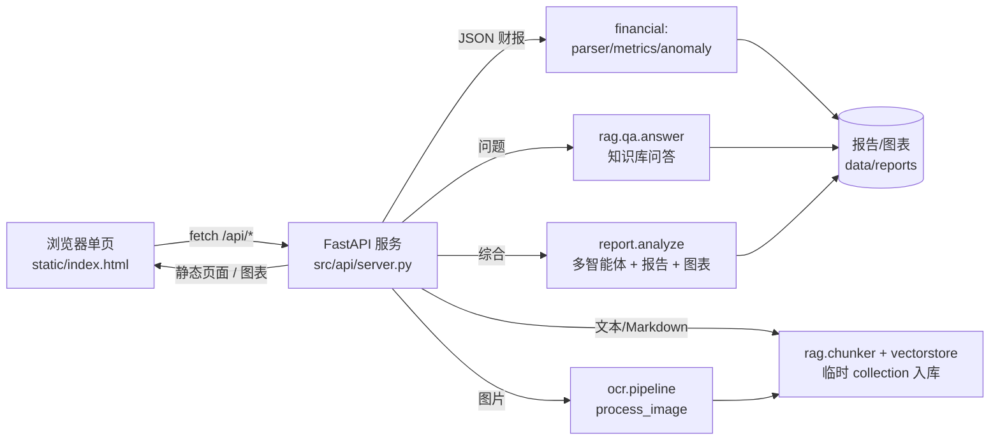

# 前端界面设计文档

> 面向「金融数据分析智能体」的前端调用方案（v0.1）
> 目标：用最简单的界面前置封装三大能力——财报分析、知识库问答、文件分析（OCR/入库）。

---

## 1. 总体架构



- **后端**：FastAPI（Python 原生，直接复用现有 `financial` / `rag` / `ocr` / `orchestrator` / `report` 模块，零额外适配层）。
- **前端**：单个 `static/index.html`，原生 HTML + CSS + JS，无 Node、无打包工具，由 FastAPI `StaticFiles`/路由直接托管。
- **模型依赖**：RAG 问答需 Ollama 已启动并拉取 `bge-m3`、`qwen2.5:7b`；OCR 用 rapidocr（已验证可跑），VLM 兜底需 `qwen2.5vl:7b`（缺失时优雅降级）。

---

## 2. 交互模型（三个核心功能）

页面只暴露**一个文件选择器 + 一个问题输入框 + 一个主按钮**，后端按「是否带文件」自动路由，完全对应需求中的三个想法：

| 用户操作 | 前端动作 | 后端路由 |
|---|---|---|
| ① 选择文件 | `<input type=file>` 选财报/图片/文档 | 进入「文件分析」分支 |
| ② 点击「分析 / 查询」并带文件 | `POST /api/analyze`（multipart: file + query） | 按扩展名分流（见 §3） |
| ③ 不传文件、直接提问 | `POST /api/analyze`（仅 query） | 调用 `rag.qa.answer` 走知识库 |
| （可选）生成完整报告 | `POST /api/report`（JSON: query） | `report.analyze` 跑多智能体闭环 + 出图 |

> 需求原话「不上传文件，则调用知识库查询」——即**同一个输入框**：带文件=分析文件，不带文件=知识库查询。前端可用一个按钮智能路由，也可拆成「分析文件」「知识库查询」两个按钮（更直观）。

---

## 3. 文件类型路由（后端核心逻辑）

后端收到文件后按扩展名分发，且**上传内容写入独立临时 collection，绝不污染共享知识库 `finance_kb`**：

- **`.json`（财报）** → `financial.parser.load_pair` → `compute_ratios` / `compare_yoy` / `detect_anomalies`，返回指标表 + 异常清单；若同时带问题，额外补一次知识库回答。
- **图片**（`.png/.jpg/.jpeg/.bmp`） → `ocr.pipeline.process_image` 提取文字 → 写入临时 collection → 用问题做 RAG 问答（即「分析这张财报图」）。
- **`.txt / .md`** → 切分入库到临时 collection → RAG 问答 / 摘要。
- **其他类型** → 返回 400 明确提示不支持（PDF 接入见 §6 后续项）。

每次上传分析结束后删除该临时 collection，避免磁盘无限增长。

---

## 4. API 契约

```
POST /api/analyze
  Content-Type: multipart/form-data
  fields: file?(二进制), query?(文本)
  响应 200:
  {
    "mode": "kb" | "financial" | "ocr" | "ingest",
    "answer": str,            # 文件分析结论 或 知识库回答
    "sources": [str],         # 溯源（文件名 / doc_id+位置）
    "details": {...},         # 指标/同比/异常/识别文本等结构化数据
    "kb_supplement"?: str     # 仅 financial 模式、且带问题时出现
  }

POST /api/report
  Content-Type: application/json
  body: { "query": str }
  响应 200:
  {
    "summary", "overall_confidence", "human_in_the_loop",
    "disclaimer", "conflicts",
    "report_markdown": str,    # 完整 Markdown 报告正文
    "figures": [url],          # /figures/<name> 可直接  引用
    "report_path": str
  }

GET  /             -> 单页前端 index.html
GET  /figures/{name} -> 报告图表静态资源
```

详细字段与示例见《接口开发文档.md》。

---

## 5. 前端页面（static/index.html，极简）

- 顶部：标题 + 合规免责提示条。
- 文件选择框：「上传财报 / 文档 / 图片」。
- 文本输入区：「输入问题，或留空仅分析文件」。
- 按钮：`分析 / 查询`、`生成完整报告`。
- 结果区四块：`结论`、`溯源来源`、`明细（指标表 / 异常列表 / OCR 原文）`、`图表`（report 模式）。
- 交互：用 `fetch` 调接口，拿到 JSON 后渲染；加载态 / 错误态有提示。

---

## 6. 后续可扩展项（非本期）

1. **PDF 支持**：接入 `pdf2image`/`pymupdf` 转图后走 OCR 分支。
2. **会话态上传**：支持多文件、跨轮引用同一份上传文档（复用临时 collection 的 id）。
3. **鉴权与多用户**：当前为单机演示，无登录；生产需加鉴权与租户隔离。
4. **流式输出**：`/api/analyze` 改为 SSE，逐步返回 LLM 生成内容。
5. **可视化增强**：在前端直接渲染指标趋势图，而非仅展示后端生成的静态图。

---

## 7. 运行方式

```bash
bash run_app.sh
# 或
.venv/bin/python -m uvicorn src.api.server:app --host 0.0.0.0 --port 8000
```

浏览器访问 `http://localhost:8000/` 即可使用。
