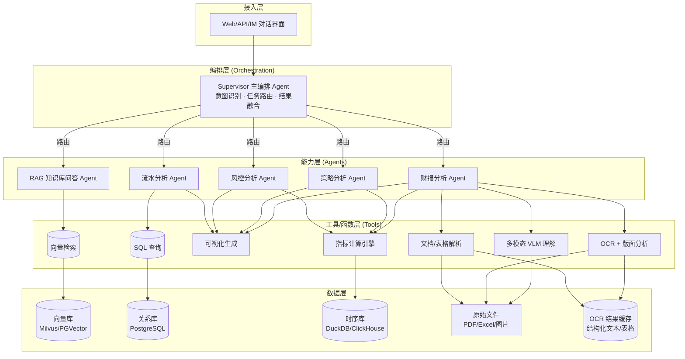
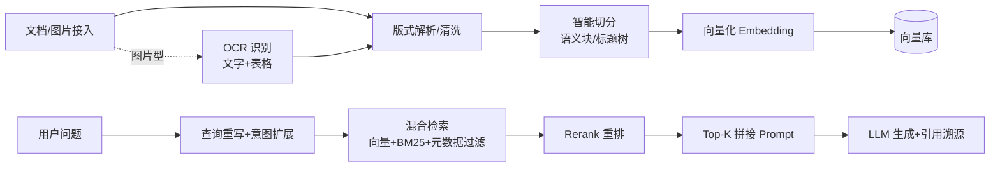
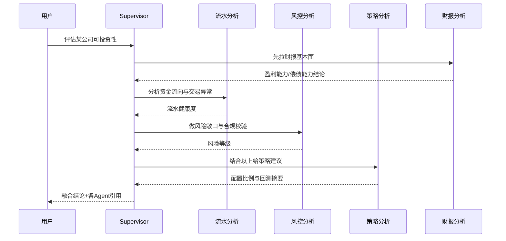
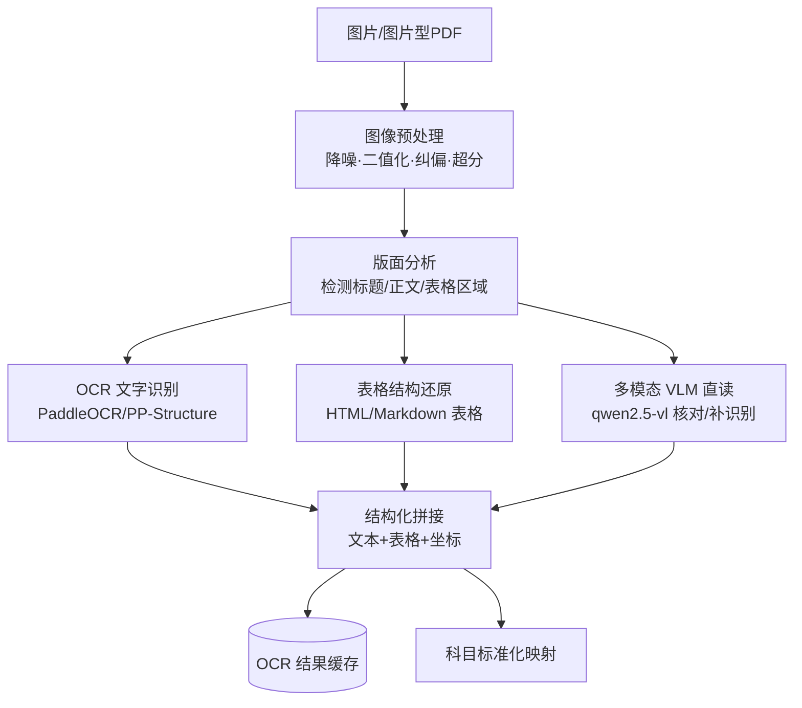
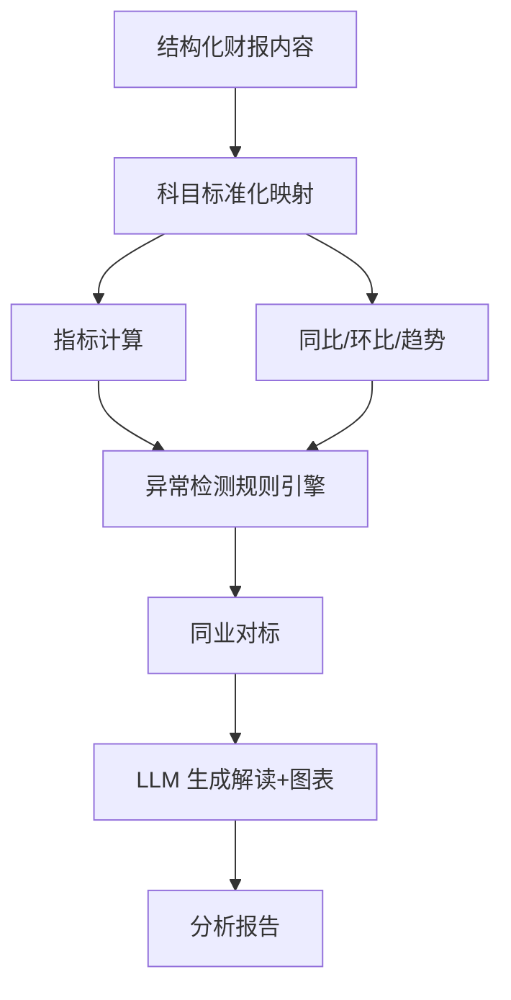
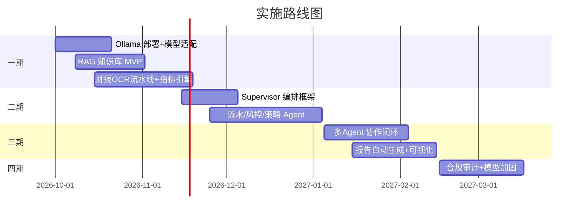

# 金融数据分析智能体 — 设计文档（v0.2）

## 1. 项目定位与目标

**定位**：面向金融场景的"分析增强型"智能体（Analysis-Augmented Agent），将大模型的自然语言理解能力与严谨的量化分析、规则引擎、知识检索结合，降低金融数据分析的门槛、提升研究效率。

**三大核心功能**

| 模块 | 解决的问题 | 典型用户意图 |
|------|-----------|-------------|
| RAG 知识库问答 | 非结构化金融知识快速检索与可信问答 | "某行业监管新规要点是什么？" |
| 多智能体协作 | 复杂任务分解、专业视角交叉验证 | "帮我做这家公司全面的投研分析" |
| 财报分析 | 结构化财报的自动解析、指标计算与归因 | "解读某公司最新季报，找出异常科目" |

**目标用户**：投研分析师、风控合规人员、量化策略研究员、个人投资者。

---

## 2. 总体架构

采用"**编排层 + 能力层 + 数据层**"分层架构，核心是一个 `Supervisor（主编排智能体）` 负责意图识别与任务路由。

**关键设计原则**
- **Supervisor 不自己算数**：只做"调度 + 汇总"，所有计算下沉到工具层，保证可解释、可校验。
- **单一职责 Agent**：每个子 Agent 只精通一个领域，通过结构化消息（JSON Schema）相互通信。
- **人在回路（Human-in-the-loop）**：涉及交易建议、合规结论时必须有"引用来源"和人工确认环节。

---

## 3. 核心模块设计

### 3.1 RAG 知识库问答

**支持的语料类型**：监管法规、行业/公司研报、招股书与年报、新闻公告、内部投研笔记。

**处理流水线**

**关键设计点**
- **切分策略**：金融文档长、结构化强，建议基于"标题层级 + 表格边界"做语义切分，避免切断表格。
- **图片型文档预处理**：当语料为扫描图片/图片型 PDF 时，先经 OCR + 版面分析还原为带坐标的文本与表格，再进入切分；OCR 结果按 `doc_id + 页码` 缓存，避免重复识别。
- **混合检索**：`向量召回（语义）+ BM25（精确术语如股票代码、法规条款号）+ 元数据过滤（时间/行业）` 三路融合。
- **重排**：用 Cross-Encoder Reranker 提升精度。
- **引用溯源**：生成结果必须带 `doc_id + 页码 + 段落`，避免幻觉，满足合规审计。
- **增量更新**：支持定时/事件触发的增量入库，保留版本与失效时间。

### 3.2 多智能体协作

采用 **Supervisor + Worker** 模式（可用 LangGraph 的 `MultiAgent` 或 AutoGen `GroupChat` 落地）。

| Agent | 职责 | 核心工具 |
|-------|------|---------|
| **流水分析 Agent** | 交易流水/资金流向分析、异常交易识别、客户行为画像 | SQL 查询、聚类、可视化 |
| **风控分析 Agent** | 信用/市场/流动性风险评估、指标预警、合规校验 | 风险指标引擎、规则引擎、阈值监控 |
| **策略分析 Agent** | 因子挖掘、回测框架、收益风险归因、组合建议 | 回测引擎、因子库、优化器 |

**协作流程示例**（用户："评估某公司是否可纳入投资组合"）

**通信契约**：Agent 间通过统一 JSON Schema 消息传递（输入/输出/置信度/数据来源），便于 Supervisor 做冲突检测与加权融合。

### 3.3 财报分析

**输入特征**：多数财报文件为**扫描图片 / 图片型 PDF**，无原生文本层，必须先经过 OCR 与版面分析才能进入结构化解析。因此本模块以"**图片感知（OCR + VLM）**"为前置，再衔接指标计算与归因。

**OCR / 多模态前置流水线**

**能力拆解**
1. **图像预处理**：针对扫描噪点、倾斜、低分辨率做降噪、二值化、纠偏与超分辨率放大，提升 OCR 召回率。
2. **版面分析 + OCR**：用 PaddleOCR / PP-StructureV2 做区域检测与文字、表格识别，将财报还原为带坐标的结构化文本与 Markdown 表格。
3. **多模态 VLM 兜底**：对 OCR 易错的复杂表格、合并单元格、手写批注，调用本地 VLM（如 qwen2.5-vl）做"看图直读"与交叉校验，纠正识别偏差。
4. **指标计算引擎**：盈利能力（ROE/ROA/毛利率）、偿债能力（资产负债率/利息保障倍数）、运营能力（周转率）、成长性（营收/利润同比环比）。
5. **异常检测**：科目同比变动超阈值、应收/存货异常膨胀、现金流与利润背离等。
6. **同业对比**：与行业中位数/可比公司对标。
7. **自动报告**：生成结构化 Markdown/PDF 分析报告，含图表与风险提示，并标注数据来源页码/坐标以便溯源。

**解析主流程**

---

## 4. 数据层设计

| 存储 | 用途 | 选型建议 |
|------|------|---------|
| 向量库 | RAG 检索 | Milvus / pgvector / Qdrant |
| 关系库 | 结构化财务/流水数据 | PostgreSQL（+ pgvector 可二合一）|
| 分析/时序库 | 高频流水、行情回测 | DuckDB（轻量）/ ClickHouse（海量）|
| 对象存储 | 原始 PDF/Excel/图片 | MinIO / OSS |
| OCR 结果缓存 | 图片型财报识别后的结构化文本/表格，避免重复 OCR | 文件存储 + PostgreSQL |

**数据治理**：统一 `entity_id`（公司/产品维度）、时间分区、数据血缘记录，保证可回溯。

---

## 5. 技术栈建议

| 层 | 推荐 |
|----|------|
| 编排框架 | **LangGraph**（状态可控、适合 Supervisor 模式）或 AutoGen / CrewAI |
| LLM（本地） | **Ollama 本地部署**：通用编排 `qwen2.5:32b/72b`、深度推理 `deepseek-r1:32b`，通过 OpenAI 兼容接口调用 |
| 多模态 VLM（本地） | Ollama 部署 `qwen2.5-vl:7b/32b`，用于财报图片直读与 OCR 校验 |
| Embedding（本地） | Ollama 模型 `bge-m3` / `nomic-embed-text`，中文金融语料优选 bge-m3 |
| OCR / 版面 | PaddleOCR + PP-StructureV2（本地），负责文字与表格结构还原 |
| 向量库 | Milvus / pgvector |
| 计算/分析 | Python（pandas/polars）、DuckDB、回测用 backtrader/zipline 或自研 |
| 文档解析 | PaddleOCR / PP-Structure（图片型）、unstructured / MinerU（文本型）|
| 服务 | FastAPI + 异步任务队列（Celery/RQ）|
| 前端 | Streamlit（快速原型）/ React + Ant Design（产品化）|

---

## 6. 安全与合规要点

- **数据分级**：客户流水、未公开财报属敏感数据，需加密存储 + 访问审计。
- **合规免责**：生成内容需标注"AI 生成，不构成投资建议"，交易类结论强制人工复核。
- **可解释性**：所有结论可追溯到原始数据/文档片段。
- **模型隔离**：全部模型经 Ollama 本地部署，内部研报/客户数据不出内网，天然满足私有化与数据不出域要求。

---

## 7. 本地模型（Ollama）部署与适配

**部署形态**
- 在带 GPU 的推理服务器（或开发机）运行 `ollama serve`，通过 OpenAI 兼容接口（`/v1/chat/completions`）供编排框架调用，全程不出内网。
- 按角色拆分模型，避免单一小模型兼顾所有任务：
  - 编排 / 通用对话：`qwen2.5:32b` 或 `qwen2.5:72b`（按显存选配）
  - 深度推理 / 分析：`deepseek-r1:32b`（复杂归因、风控推理）
  - 向量化：`bge-m3` 或 `nomic-embed-text`
  - 多模态：`qwen2.5-vl:7b/32b`（财报图片直读）

**本地模型适配要点**
- **上下文与显存**：本地模型上下文窗口与并发有限，需设置 `num_ctx`、批处理与队列限流；长文档走"检索-切片-分块推理"，不整篇塞入上下文。
- **工具调用（Function Calling）**：确认所选模型支持 tool calling（qwen2.5 / llama3.1 系列均支持），否则 Agent 编排需降级为"提示词驱动 + 正则抽取"方案。
- **推理速度与吞吐**：本地模型首 token 延迟与吞吐低于云端，对 RAG 生成、报告生成等重任务需异步化与结果缓存。
- **数值一致性**：本地小模型易漂移，关键数值（指标、金额）一律以"规则引擎 / SQL 计算"为准，LLM 只做解读，不负责算数。
- **模型与提示词版本化**：通过 Ollama `Modelfile` 固化系统提示词与采样参数，对模型与提示词做版本管理，便于回滚与审计。

---

## 8. 实施路线图

